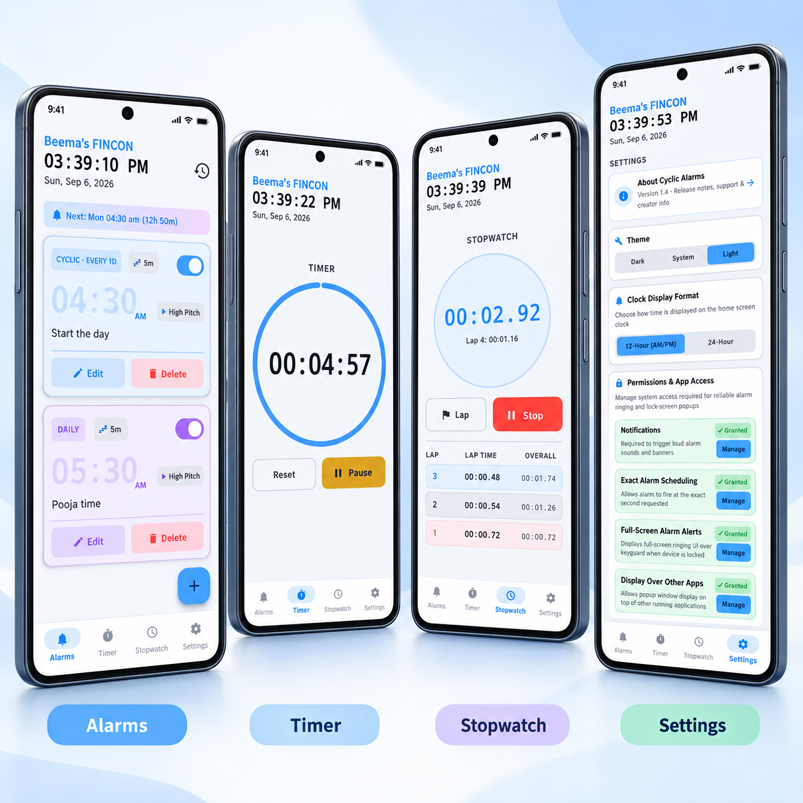
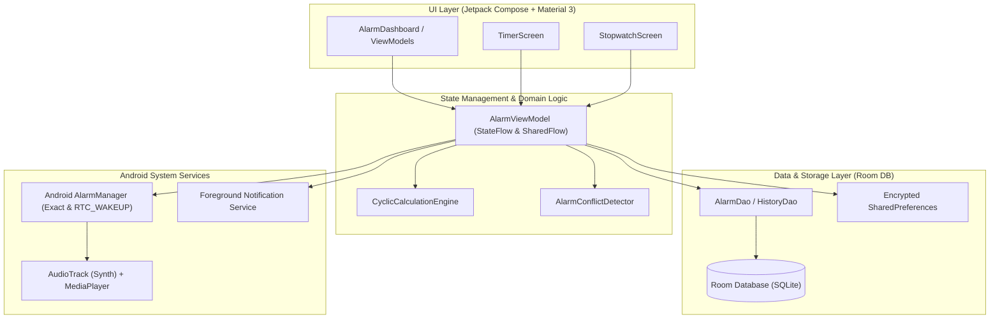

# Cyclic Alarms

[](https://opensource.org/licenses/Apache-2.0)
[](https://f-droid.org/en/packages/com.beemasfincon.cyclicalarms/)
[-green.svg)](https://android.com)
[](https://kotlinlang.org)
[](https://developer.android.com/jetpack/compose)
[](#architecture)
[](#privacy--permissions)

> A modern, robust, **100% ad-free & offline** Android alarm clock built for irregular rosters, shift workers, rotating schedules, and custom cyclical routines that standard weekly alarm apps cannot handle.

---

<p align="center">
  
</p>

---

## 📌 Table of Contents

- [Core Capabilities](#-core-capabilities)
- [Architecture & Tech Stack](#-architecture--tech-stack)
- [Project Structure](#-project-structure)
- [Engine Highlights](#-engine-highlights)
  - [1. Flexible Recurrence Engine](#1-flexible-recurrence-engine)
  - [2. Conflict & Collision Detection](#2-conflict--collision-detection)
  - [3. Lock Screen Over-Keyguard Ringing](#3-lock-screen-over-keyguard-ringing)
  - [4. Synthesized Audio Engine](#4-synthesized-audio-engine)
- [Privacy & Permissions](#-privacy--permissions)
- [Building & Development](#-building--development)
- [Changelog](#-changelog)
- [License & Contributions](#-license--contributions)

---

## ⚡ Core Capabilities

- 🔁 **Flexible Recurrence Patterns**:
  - **Once (One-off)**: Single execution; automatically disables upon ringing or dismissal without ghost alarms.
  - **Daily & Cyclic**: Recur daily or every $N$ days (e.g., every 3, 4, 14 days) anchored from a precise epoch date.
  - **Weekly**: Multi-day weekday masks (Mon–Sun combinations).
  - **Monthly**: Recur on fixed day of month (e.g., 20th), ordinal day of week (e.g., 3rd Tuesday), or multi-select dates grid.
  - **Yearly**: Recur annually on fixed calendar dates or ordinal weekday expressions.
- ⚠️ **Duplicate Time Collision Detection**: Proactive 365-day projection checks to identify overlapping alarms on matching dates with non-blocking confirmation dialogs.
- 📐 **Adaptive UI Density**: Seamless toggle between rich visual Cards and ultra-dense List view (~58dp) with SharedPreferences persistence.
- ⏱️ **Multi-Timer & Stopwatch System**:
  - Run up to 5 concurrent timers with individual progress tracking.
  - Millisecond-precision stopwatch with lap delta analysis.
  - Background execution powered by persistent, non-dismissible Foreground Services.
- 🔔 **Snooze Engine & Dynamic Notifications**: Real-time ticking down countdown notifications with immediate action buttons.
- 🎨 **Display & Theming**:
  - True AMOLED pure black theme (`#000000`) for maximum power efficiency on OLED panels.
  - Light mode with customizable background luminosity slider.
  - 12-Hour / 24-Hour time format consistency across all views and alerts.
- 🌐 **100% Offline Multi-Language Support**: Complete native localization for 11 languages (English, Arabic, German, Spanish, French, Hindi, Japanese, Portuguese, Russian, Turkish, Chinese).

---

## 🛠 Architecture & Tech Stack

The application follows Google's recommended Android Architecture Guidelines with a reactive, unidirectional data flow (UDF) powered by Kotlin Coroutines & Jetpack Compose:



### Technical Specifications

| Layer | Component / Library | Details |
|---|---|---|
| **Language** | Kotlin 2.0+ | Modern idiomatic Kotlin, Coroutines, Flow |
| **UI Framework** | Jetpack Compose + Material 3 | Declarative, pure Kotlin UI with edge-to-edge support |
| **Architecture** | MVVM / UDF | Clean separation of UI, Domain, and Local Data |
| **Database** | Room 2.6.x | SQLite abstraction, type converters, asynchronous DAOs |
| **Exact Scheduling** | `AlarmManager` | `setExactAndAllowWhileIdle()` via `RTC_WAKEUP` |
| **Audio Synthesis** | `AudioTrack` | Programmatic waveform synthesis (2400Hz/3200Hz tones) |
| **Background Ops** | Android Foreground Service | Ongoing persistent notifications for active timers/stopwatch |
| **Minimum SDK** | Android 7.0 (API 24) | Compatible through Android 15 (API 35) |

---

## 📂 Project Structure

```
Cyclic-Alarms/
├── app/
│   ├── build.gradle.kts                   # Dependency declarations & compile configs
│   └── src/main/
│       ├── AndroidManifest.xml             # System permissions & Service declarations
│       ├── java/com/example/
│       │   ├── data/
│       │   │   ├── Alarm.kt               # Core Entity model
│       │   │   ├── AlarmDao.kt            # Room database access interface
│       │   │   ├── AlarmDatabase.kt       # Room database instance & migrations
│       │   │   └── AlarmConflictDetector.kt# Duplicate time collision engine
│       │   ├── service/
│       │   │   ├── AlarmReceiver.kt       # BroadcastReceiver triggered by AlarmManager
│       │   │   ├── AlarmRingingService.kt # Foreground service handling alert & keyguard
│       │   │   └── TimerService.kt        # Persistent background timer/stopwatch service
│       │   ├── ui/
│       │   │   ├── AlarmDashboard.kt      # Main alarm list & responsive card layouts
│       │   │   ├── AlarmViewModel.kt      # Presentation state management
│       │   │   ├── RingingActivity.kt     # Full-screen lock-screen alert activity
│       │   │   ├── TimerScreen.kt         # Countdown timer UI & controls
│       │   │   ├── StopwatchScreen.kt     # Precision stopwatch & lap times
│       │   │   └── theme/                 # Dynamic light/dark/AMOLED palette
│       └── res/
│           ├── values/strings.xml         # Base strings
│           └── values-*/strings.xml       # 11 offline localized translations
├── fdroid/
│   └── com.beemasfincon.cyclicalarms.yml   # F-Droid build recipe metadata
├── fastlane/metadata/android/              # Play/F-Droid changelogs and release notes
└── README.md
```

---

## 🧠 Engine Highlights

### 1. Flexible Recurrence Engine
Unlike stock Android clocks that compute repeats on a 7-day bitmask, Cyclic Alarms evaluates calendar schedules through a mathematically rigorous projection:
- **Cyclic Calculation**: Computes $(TargetDate - AnchorDate) \pmod N == 0$, correctly accounting for leap years, daylight saving time (DST) shifts, and variable month lengths.
- **Ordinal Computations**: Dynamically computes patterns such as "the 3rd Tuesday" using `java.util.Calendar` day-of-week ordinal indices.

### 2. Conflict & Collision Detection
To prevent user confusion caused by accidental duplicate alarms:
- When a user adds or edits an alarm, `AlarmConflictDetector` simulates scheduled ring timestamps across all enabled alarms for a 365-day forward horizon.
- Collisions trigger an interactive warning dialog prompting the user to either review their settings or intentionally proceed with the overlap.

### 3. Lock Screen Over-Keyguard Ringing
Alarms must ring reliably without compromising device security:
- Implements `setShowWhenLocked(true)` and `setTurnScreenOn(true)` combined with `FLAG_KEEP_SCREEN_ON`.
- Displays strictly scoped ringing controls over the keyguard. Once snoozed or dismissed, the ringing activity finishes immediately, leaving the device locked without exposing the dashboard.

### 4. Synthesized Audio Engine
- Built-in alarm sounds (High Pitch, Zen Bowl, Cyber Alert, etc.) are generated mathematically via raw PCM byte streams fed into `AudioTrack`.
- No bloated static MP3/WAV assets are shipped in the APK, keeping the application payload under **~6 MB**.

---

## 🔒 Privacy & Permissions

This application is engineered under a zero-trust, privacy-first model:

| Permission | Purpose |
|---|---|
| `SCHEDULE_EXACT_ALARM` | Required on Android 12+ for exact-to-the-second alarm triggering |
| `USE_EXACT_ALARM` | Standard F-Droid / power clock permission for mission-critical alerts |
| `USE_FULL_SCREEN_INTENT` | Allows alarm ringing screen to wake and display over the keyguard |
| `POST_NOTIFICATIONS` | Displays snooze countdowns and persistent timer indicators |
| `WAKE_LOCK` | Keeps CPU awake momentarily while sound streams initialize |
| `FOREGROUND_SERVICE` | Manages ongoing background timers and stopwatches |

> **Privacy Guarantee**: Cyclic Alarms contains **no network permissions** (`android.permission.INTERNET` is completely absent from the manifest). No analytics, no crash reporters, no tracking, and no external API calls.

---

## 🔨 Building & Development

### Prerequisites
- **JDK**: OpenJDK 17 or 21
- **Android SDK**: Build Tools `34.0.0` or higher, Platform `android-35`
- **Gradle**: Wrapper configured (Gradle 9.x)

### Local Build Instructions

Clone the repository and build via Gradle:

```bash
# Clone the repository
git clone https://github.com/pramodbeema/cyclic-alarms.git
cd cyclic-alarms

# Build debug APK
./gradlew assembleDebug

# Run unit and lint checks
./gradlew test lint
```

The compiled APK will be located at:
```
app/build/outputs/apk/debug/app-debug.apk
```

---

## 📦 F-Droid Release Pipeline

<p align="left">
  <a href="https://f-droid.org/en/packages/com.beemasfincon.cyclicalarms/">
    
  </a>
</p>

Cyclic Alarms is built directly from source by the F-Droid build server using reproducible metadata:
- **Package ID**: `com.beemasfincon.cyclicalarms`
- **Recipe Location**: [`fdroid/com.beemasfincon.cyclicalarms.yml`](file:///fdroid/com.beemasfincon.cyclicalarms.yml)
- **Tag Standard**: Official releases use semantic tags prefixed with `v` (e.g., `v1.8.3`).
- **Version Code Standard**: 10-digit format (`YYYYMMDD##`) to guarantee strictly monotonically increasing integers across F-Droid infrastructure.

---

## 📝 Changelog

### v1.8.3
- ⏰ **Duplicate Time Conflict Check**: Real-time collision detection for identical times on the same date with confirmation prompts.
- 📐 **Screen Space Optimization**: Removed top app name header and streamlined Next Alarm indicator into an ultra-compact chip.
- 📑 **View Mode Switcher**: Added user-selectable Cards and List (~58dp) views with persistent state.
- 🎨 **Unified Transparent Icon**: Completely transparent background and standardized safe-zone geometry across all launcher formats.

*(For full historical release notes, see the in-app About section or git tags).*

---

## 📄 License & Author

- **Author**: Pramod Beema ([bp.beema@outlook.com](mailto:bp.beema@outlook.com))
- **Organization**: Beema's FINCON
- **License**: [Apache License 2.0](LICENSE)
