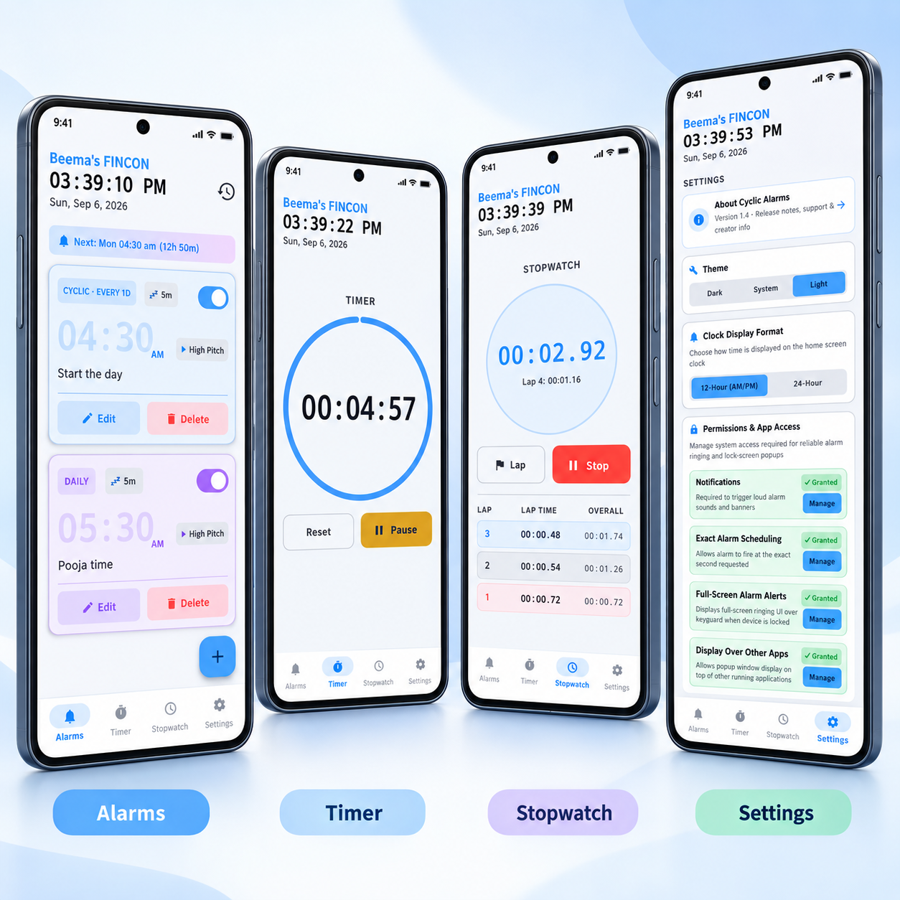

# Beema's FINCON — Cyclic Alarms

> A simple, **100% ad-free** alarm app built for people who work shift schedules, rotating rosters, or any repeating cycle that doesn't fit a standard Mon–Fri pattern.

---

## What this app does

Most alarm apps only support weekly repeats — same days every week. If your work schedule repeats every 3 days, every 5 days, or any other interval, you're stuck setting alarms manually each time.

**Cyclic Alarms** solves exactly that. You pick a start date and an interval, and the alarm fires on that cycle forever — no manual resetting needed.

It also supports regular weekly alarms (pick any days of the week), so it covers everyday use too.

That's it. No subscriptions, no ads, no accounts, no permissions beyond what's needed to actually ring an alarm.

---

## Features

- **Flexible Recurrence Cycles** — Once (ring once, then auto-disable), Daily (everyday or N-day interval), Weekly (weekdays), Monthly (e.g. 20th, 3rd Tuesday, or selected dates grid), and Yearly (e.g. 20th Oct, 3rd Tuesday of Oct, or selected months)
- **Cyclic alarms** — repeat every N days from a start date (e.g. every 3 days, every 14 days)
- **Weekly alarms** — pick any combination of weekdays
- **Multiple Timers** — run up to 5 independent countdown timers simultaneously, each with its own label and progress bar
- **Stopwatch** — elapsed time tracker with lap recording, fastest/slowest lap highlights, and touch audio feedback
- **Background Timer & Stopwatch** — continue running when the app is backgrounded via a Foreground Service with a persistent, non-dismissible notification (like YouTube playback) — shows live countdown and a "Stop All" action
- **Persistent Custom Track** — last-used audio file is automatically pre-applied to every new alarm; no need to re-pick each time
- **Rings in Silent & DND Mode** — alarm stream volume is forced to maximum before playing, bypassing silent/vibrate mode
- **Pure Dark Mode** — true AMOLED black theme for OLED screens (saves battery, looks sharp)
- **Dark / Light / System themes** — with a brightness slider in Light mode to dial background from tinted grey to pure white
- **Strict Lock Screen Security** — app ONLY displays over keyguard while actively ringing; dismiss/snooze immediately returns to lock screen
- **4-Tab Navigation** — Alarms, Timer, Stopwatch, Settings
- **12H / 24H Clock Consistency** — alarm times across the alarms list, Next Alarm pill, Add/Edit dialogs, sound previews, full-screen ringing, and notifications strictly follow your chosen clock format
- **Per-Alarm Snooze Duration** — set snooze minutes per alarm (quick presets + custom input)
- **First-launch Theme Prompt** — pick your theme on first install, with correct status bar contrast
- **In-App Permissions Manager** — view and manage all critical permissions live in Settings
- **Alarm history** — log of dismissed and snoozed alarms with clear option
- **8 built-in alarm sounds** — High Pitch, Zen Bowl, Sunrise Chime, Digital Beeps, Morning Forest, Synth Wave Beat, Cyber Alert, Lofi Chord
- **Custom audio** — use any audio file from your device as an alarm sound
- **Volume & vibration control** — per-alarm, volume defaults to maximum
- **Expandable release notes** — collapsible version history on the About page
- **Zero ads. Zero tracking. Zero sign-in.**

---

## Screenshots

  

---

## Installation

### 📲 Install via F-Droid
Cyclic Alarms is an official open-source package published on **F-Droid**:
- Search for **Cyclic Alarms** directly in the [F-Droid app](https://f-droid.org/) or install via the official F-Droid repository.
- Built from source and signed directly by F-Droid's trusted build infrastructure.

---

## Tech stack

- **Language:** Kotlin
- **UI:** Jetpack Compose (Material 3)
- **Data:** Room database (SQLite)
- **Audio:** Android AudioTrack + MediaPlayer — all synth sounds are generated in code, no audio files bundled
- **Scheduling:** AlarmManager with exact alarms
- **Min SDK:** Android 7.0 (API 24)

---

## AI disclosure

This app was built **100% using AI assistance** (Google Antigravity AI / Claude). Every line of Kotlin, every layout, every fix — written by AI based on my descriptions of what I wanted.

I'm not a software developer. I'm just someone who needed a specific alarm app, couldn't find one that did exactly what I wanted, and used AI to build it. The ideas, requirements, and testing are mine — the code is the AI's.

---

## What's new — v1.7.3

- ⏰ **Dedicated "Only Once" Alarm Option** — explicitly set one-off alarms via the new "Once" tab in recurrence options; alarms ring once at the set time and automatically disable upon ringing or dismissal.
- ⏱️ **Timer Label & Sequential Numbering** — resolved the `%d` display formatting glitch in timer cards and enabled automatic sequential re-numbering (Timer 1, Timer 2...) so remaining timers are properly numbered when a timer is deleted.

## What's new — v1.7.2

- 🔒 **Timer Lock Screen Fix** — stopping or resetting a ringing timer immediately restores the phone to its pre-alert lock screen state without requiring an extra unlock.
- 🔕 **No Duplicate Notifications** — suppressed redundant heads-up notification shade banners while the timer full-screen ringing UI is actively showing.

## What's new — v1.7.1

- 🕒 **Comprehensive 12H / 24H Time Format Consistency** — all alarm times across dashboard alarm cards, next alarm header pill, edit dialogs, sound preview, full-screen ringing, and system notifications now strictly respect the 12-hour or 24-hour clock setting.
- 🔄 **Flexible Recurrence Engine** — support for Daily (everyday or interval), Weekly, Monthly (repeat on the 20th, the 3rd Tuesday, or selected dates grid), and Yearly recurrence cycles (repeat on 20th October, the 3rd Tuesday of October, or the 20th of selected months).

## What's new — v1.7

- 🔔 **Live Snooze Notification with Countdown** — when an alarm is snoozed, an ongoing notification displays a live ticking countdown of remaining time, the exact time it was snoozed, the snooze duration, and an instant Dismiss button.
- ⏰ **Enhanced Snoozed Ringing Screen** — full-screen ringing now prominently displays the live current time, date, and a dedicated badge showing the exact timestamp when the alarm was snoozed and the snooze duration.

## What's new — v1.6.5

- ⏰ **One-Off Alarm Fix** — alarms set without weekdays or cyclic days (ONE-OFF) now automatically disable upon ringing and dismissal, properly executing once instead of recurring daily.

## What's new — v1.6.4

- 🌐 **Comprehensive End-to-End Offline Localization** — all screens, tabs, dialogs, empty states, history logs, alarms editor, timers, stopwatch, settings, and lock-screen ringing UI are 100% translated across 11 languages (English, Turkish, Spanish, German, French, Hindi, Portuguese, Russian, Chinese, Japanese, Arabic) and System Default.
- 🚀 **First-Run Language Gate** — language selection dialog is presented immediately on first launch before the permission gate or dashboard, ensuring user can interact in their preferred language right away.
- 🔢 **Universal Digit Readability** — numerals remain strictly formatted in standard numbers (`1, 2, 3...`) across all localized displays.

## What's new — v1.6.3

- 🌐 **Full Offline Multilingual Localization** — complete offline UI translations for 11 global languages (English, Turkish, Spanish, German, French, Hindi, Portuguese, Russian, Chinese, Japanese, Arabic) plus System Default. No internet or external APIs required.
- 🚀 **First-Run Onboarding Setup** — select both your preferred language and theme on initial app launch.
- ⚙️ **In-App Language Settings** — change the application display language anytime in Settings without leaving the app.

## What's new — v1.6.2

- 🛡 **Android 9 Compatibility Fix** — fixed cold-launch abrupt quits on Android 9 and older legacy devices.
- ⏱ **Timer & Stopwatch API Guard** — guarded API 31 foreground service notification methods to ensure reliable background tracking on all Android versions.
- 🔇 **Timer Alert Stop on Clear/Reset** — tapping Clear or Reset now immediately silences finished timer ringing.
- 🧭 **Smart Notification Navigation** — notification title dynamically reflects Timer vs Stopwatch and notification taps bring you straight to the active tab.
- 🔒 **Clean Alarm Lifecycle** — guaranteed immediate dismiss & lock screen restore without background dashboard leakage.

## What's new — v1.6.1

- 📦 **F-Droid Compliance** — clean open-source metadata, Apache-2.0 license, and removed proprietary network update checkers.
- 🔑 **Permission Streamlining** — refined permission cards and setup flow for modern and legacy Android systems.

## What's new — v1.6

- 🔔 **Non-dismissible background notification** — timer & stopwatch notification cannot be swiped away while running (just like a YouTube playback notification); includes a "Stop All" action button so you can still stop from the shade
- 🎨 **Light mode alarm time fix** — cyclic and weekly alarm times now use deep, high-contrast colours (deep blue / deep purple) instead of the washed-out near-white tints that were invisible on a light background
- 🌤 **Deeper light mode tint** — default background is a more noticeably grey-blue so the whiteness slider feels meaningful and usable across its full range

## What's new — v1.5

- 🎵 **Persistent Custom Track** — last-used music file auto-applied to every new alarm
- ⏱ **Multiple Timers** — run up to 5 independent countdown timers simultaneously
- 🌑 **Pure Dark Mode** — true AMOLED black theme for OLED screen battery savings
- ☀️ **Light Mode Brightness Slider** — adjust background from tinted grey to pure white in Settings
- 🔄 **Background Timer & Stopwatch** — continue running when app is backgrounded via Foreground Service
- 🔔 **Rings in Silent & DND Mode** — alarms bypass ringer volume; one-time info banner confirms this

## What's new — v1.4

- 🏷 **Official Package Name** — rebranded package identity to `com.beemasfincon.cyclicalarms`
- 🎯 **Reliability Improvements** — upgraded alarm scheduling and foreground service lifecycle handling

## What's new — v1.3

- ⏱ **Timer** — built-in countdown timer with circular progress ring; time-set (HH:MM:SS) and quick presets (1m–30m) displayed **inside** the clock ring for a single-glance view; alert sound & vibration on completion
- ⏱ **Stopwatch** — millisecond-precision elapsed time tracker with lap recording, fastest/slowest lap highlights, button audio feedback, and a scrollable lap list
- 🔒 **Strict Lock Screen Security** — after dismissing or snoozing, the phone immediately returns to lock screen without exposing the main dashboard; keyguard access is scoped strictly to the ringing moment
- 🔔 **Welcome Notification** — first-launch welcome message shown to new installs
- 🎵 **Timer & Stopwatch Sounds** — timer fires system alarm ringtone + vibration; stopwatch uses audio tones on lap/start for tactile feedback
- 📱 **4-Tab Navigation + Embedded About** — Alarms, Timer, Stopwatch, Settings; About is a sub-page inside Settings
- 🌀 **Default Cyclic Days** — new alarms open on Cyclic Days tab by default
- 🖼 **Icon Fit Fix** — app icon no longer appears cropped or zoomed in on the launcher
- 🛡 **Permission Gate** — if critical permissions (Exact Alarm, Full-Screen Intent, Overlay) are not granted, the app shows a clear blocking screen with one-tap "Grant" buttons for each missing permission; app is unusable until all are granted
- ⚡ **Real-time Permission Status** — the Settings screen now re-reads all permission states the moment you return from system settings, no force-close needed
- 📋 **History Icon** — the Alarm History button now uses the correct clock-history icon instead of a generic list icon

## What's new — v1.2

- 🌀 **Pencil-Sketched Spiral Alarm Icon** — brand new centered, symmetrical pencil-sketched spiral alarm clock launcher icon
- ⏱ **Per-Alarm Custom Snooze** — set desired snooze duration per alarm (quick preset chips + custom minute input) instead of global setting
- 🔒 **Native Lock Screen Ringing** — rings over keyguard cleanly without prompting for PIN/password unlock
- 📱 **Dedicated Page Navigation** — full 4-tab bottom navigation bar for Alarms, History, Settings, and About
- 🕒 **12H / 24H Clock Toggle** — choose 12-Hour (uppercase "AM"/"PM") or 24-Hour format on the home screen clock
- 📅 **Year display in date** — home screen date format now displays the full year (e.g. Sat, Sep 5, 2026)
- 🎨 **First-Launch Theme Prompt & Status Bar Visibility** — asks theme preference on first install and ensures status bar icons stay visible on light themes
- 🔑 **In-App Permissions Manager** — live permission status badges and direct settings management in Settings
- ✉️ **Support & Community Card** — moved to About page for easy feedback & bug reporting (`bp.beema@outlook.com`)
- 📂 **Expandable Release Notes** — collapsible release note cards on About page for clean readability

## v1.1

- 🌙 Dark / Light / System theme selector in Settings
- 🕐 Alarm editor now defaults to current time
- 👁 Minute spinner visibility fix
- 🔔 New **High Pitch** alarm sound — loud dual-tone alert (2400 Hz + 3200 Hz)
- 🔊 Volume defaults to maximum for new alarms
- 🏷 "Beema's FINCON" branding on home screen

## v1.0 — Initial release

- Cyclic alarms (every N days)
- Weekly alarms (any day combination)
- 7 synth sounds + custom audio file support
- Lock screen ringing
- Snooze, vibration, alarm history

---

## Feedback

Open the **About** page in the app and tap **"Feedbacks, Suggestions or Bugs Reporting"** to send feedback directly by email to `bp.beema@outlook.com`. Or open an issue here on GitHub.

---

## License

This project is open source and available under the [Apache License 2.0](LICENSE).

